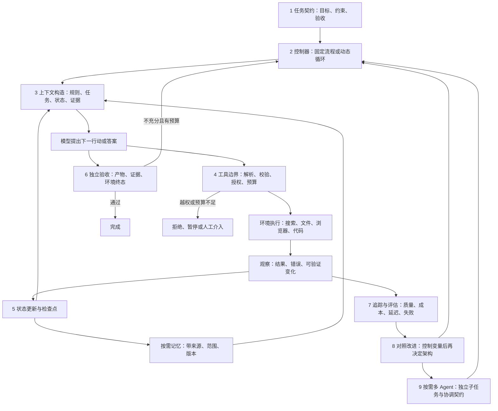

# 系统学习 AI Agent：从任务契约到可验证执行

研究与访问日期：2026-10-19，Asia/Shanghai。起点：基础 Python、大模型基本概念。目标：能够独立设计、实现、评估和改进 Agent。研究窗口按首次公开日期计算：2023-10-19—2026-10-19；更早的 ReAct、Toolformer、ToT、Reflexion、MemGPT、WebArena、AutoGen 单列为机制前置，不能用修订日期把它们包装成近三年新作。

先读本页和《01-核心知识手册》的前六张卡，然后在实践目录运行 `python3 minimal.py`。能解释每条消息为什么出现后，再做参数错误、提前结束、中断恢复实验。暂时不需要学习强化学习训练、分布式共识或同时掌握多个框架。

## 一张知识地图

数字代表学习顺序。贯穿所有阶段的是“模型可以提出行动，应用代码决定允许什么，环境提供事实，验收器决定是否完成”。这是一种实用教学定义，不声称学界对 Agent 有唯一边界。

## 七个起点问题的直接答案

1. **比普通调用多什么？** 普通调用可以一次生成答案；Agent 系统维护目标与执行状态，根据观察继续选择行动，并执行、核验、停止。多轮聊天、长推理、一次函数调用不自动意味着可靠的 Agent。
2. **谁做什么？** 模型负责不确定的语义判断和候选行动；代码负责可强制的规则与调度；工具是受控能力接口；状态记录已发生什么；环境是行动实际作用的对象。权限、预算、成功标准不交给模型一句话决定。
3. **固定还是动态？** 已知稳定步骤、结果格式清晰、失败路径有限时先写工作流。下一步依赖新发现、路径事先难枚举时，在局部节点加入动态决策。两者可以嵌套，没必要二选一。
4. **几个模块如何配合？** 上下文是本次决策的信息视图；状态是真实执行账本；记忆保存跨任务值得复用的信息；计划是待验证的行动假设；工具产生反馈；终止条件根据验收和预算收口。
5. **如何识别假完成？** 查文件、数据库、测试、证据覆盖和必要的人工签收，不能只看回答语气或一个 `done`。本项目会拒绝“答案恰好正确但未取证”的输出。
6. **如何受约束工作？** 调用前预留输出与工具预算，限制步骤、并发、时间与权限；调用后记录真实 usage 和观察；失败按类别处理；无法核验就报告未完成或升级人工。
7. **何时多 Agent？** 子任务可以独立调查、需要隔离上下文/权限、并行价值足够时才试。额外付出委派、重复检索、通信、汇总、冲突处理与统一验收成本。多角色提示词不能保证独立证据。

这些回答是本研究的设计归纳；原始论文与平台语义分别见 03、04，不把上述建议冒充普遍已证定律。

## 交付导航

| 文件 | 用法 |
|---|---|
| 01-核心知识手册.md | 最终能力大纲、必要前置、18 张知识卡 |
| 02-分阶段学习路线.md | 必须掌握/进阶/查阅、阶段产物与验收 |
| 03-论文与精选资料索引.md | 机制导向的论文阅读与证据边界 |
| 04-接口协议与平台边界.md | OpenAI、Claude、Gemini、MCP、A2A |
| 05-真实系统执行结构.md | 五类案例、代码入口、完整本地执行轨迹 |
| 06-框架与工程判断.md | 核验当前状态后的三种工程路线 |
| 07-失败案例与设计误区.md | 触发、证据、根因、修复与代价 |
| 08-自测与能力检查.md | 概念、设计、调试、实践题 |
| 09-参考答案与评分标准.md | 单独核对答案，避免看答案代替练习 |
| 实践/README.md | 六项递进实践、运行命令与扩展 |
| 实践/实验记录.md | 实测结果、控制变量、未验证项 |
| 研究记录/ | 初版骨架、修订、阅读范围、进度与缺口 |

## 本次交付的验证边界

已运行的是标准库教学项目、故障注入、恢复检查、计量算式和固定延迟并发对照。脚本策略替身不具有语言理解能力，其运行结果不能解释成模型成功率、规划收益或注入防御效果。真实 Responses 适配器已提供，但没有发起计费模型请求；框架部署、公开基准和浏览器环境未在本地运行。详见实验记录。

学习进度应通过独立练习与验收任务判断。
