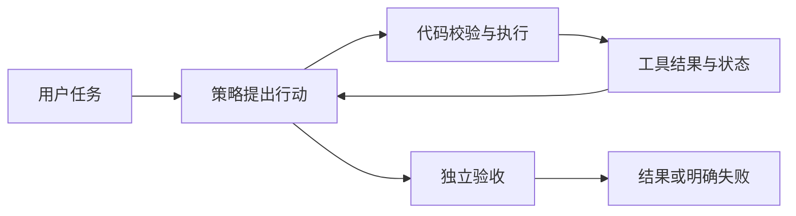

# Agent Engineering Lab

一个面向 AI Agent 工程入门的中文学习与实验仓库。从最小工具调用循环出发，逐步练习参数校验、失败处理、证据验收、检查点恢复和评估。

> **项目定位：教学实验。** 离线实验使用确定性的脚本策略和合成数据，不是实际语言模型，也不是生产环境的安全沙箱。已有真实模型接口的实验入口，但尚未进行真实 API 联网验收。

## 快速开始

需要 Python 3.9 或更新版本；离线实验仅使用 Python 标准库，无需 API 密钥。

```bash
git clone https://github.com/Mersolceil/agent-engineering-lab.git
cd agent-engineering-lab/实践
python3 minimal.py
python3 -m unittest -v
```

最小示例会打印一段 JSON：用户提出计算 `2+3`，脚本策略建议调用 `add`，工具返回 `5`，策略再输出答案 `5`。逐步实验和其他命令见 [实践指南](实践/README.md)。

## 实验内容

| 主题 | 入口 | 可以观察什么 |
| --- | --- | --- |
| 最小循环 | [minimal.py](实践/minimal.py) | 用户消息、工具建议、工具结果与最终回答 |
| 运行时与恢复 | [lab.py](实践/lab.py) | 参数校验、有限重试、终止条件和检查点 |
| 评估与计量 | [evaluate.py](实践/evaluate.py)、[metrics.py](实践/metrics.py) | 任务成功与契约符合、已知和未知成本 |
| 控制变量 | [ablations.py](实践/ablations.py)、[planning.py](实践/planning.py) | 重试预算、上下文选择和遇阻重规划 |
| 并发对照 | [compare.py](实践/compare.py) | 固定等待能否重叠；不代表模型质量提升 |



## 阅读顺序

1. [从这里开始](00-从这里开始.md)：理解 Agent 的组成和项目边界。
2. [实践指南](实践/README.md)：动手运行并修改实验。
3. [核心知识手册](01-核心知识手册.md)和[学习路线](02-分阶段学习路线.md)：按需查阅。
4. [资料索引](03-论文与精选资料索引.md)、[实验记录](实践/实验记录.md)：检查出处、运行结果和未验证事项。
5. [自测题](08-自测与能力检查.md)与[参考答案](09-参考答案与评分标准.md)：独立检查理解。

研究资料以 **2026-10-19** 的访问记录为准；平台接口和框架状态可能变化，请以链接的官方文档为准。`实践/results/` 是当时的实验快照，并非当前机器重新生成的性能成绩。

## 验证范围与局限

- 离线单元测试覆盖工具参数、终止条件、检查点恢复、计量及模拟协议映射。
- 结果基于合成数据和确定性脚本策略，不能据此推断真实模型的正确率、抗注入能力、耗时或费用。
- 对外部副作用的可靠性、严格的真实模型预算约束、框架集成和真实 API 调用仍需进一步验证。
- 论文与外部资料保留来源链接；引用论文结论不代表本仓库复现了论文实验。

## 关于本项目

本仓库由学习者与 AI 助手协作整理：研究、文档、教学代码和仓库整理均有 AI 参与。欢迎通过亲自运行、修改代码和核对资料来学习；项目中的资料与实验不等同于作者已经独立掌握全部内容。
